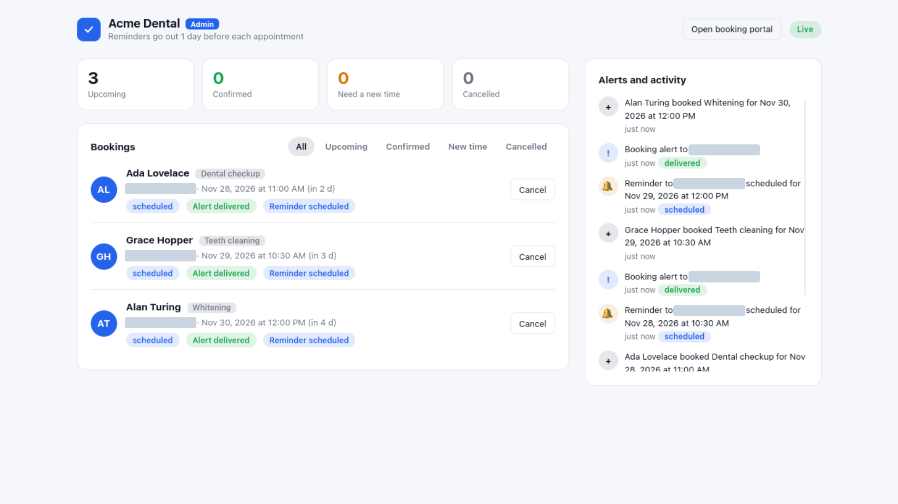
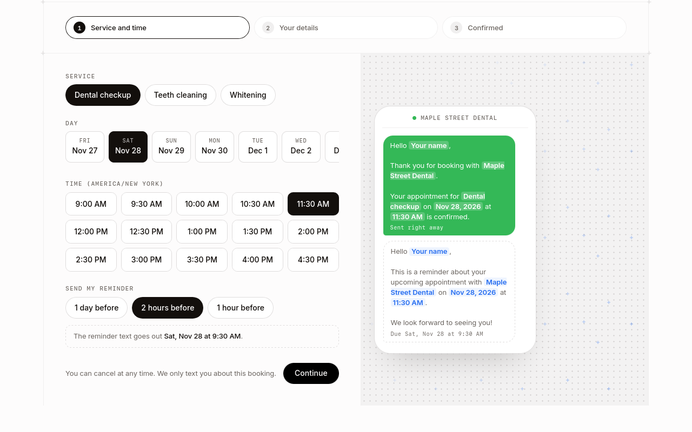
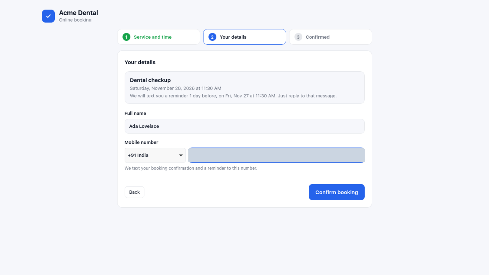
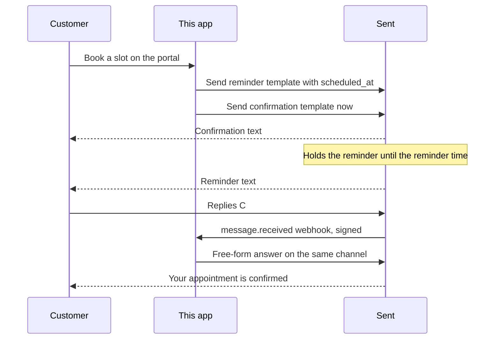
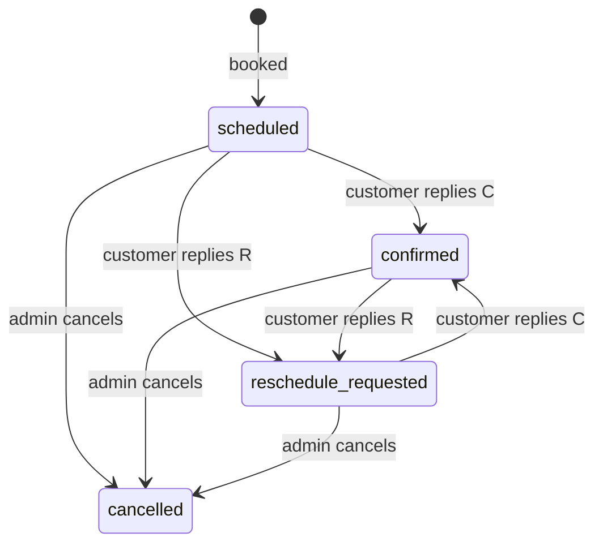

<div align="center">

# Appointment reminders with reply handling

Appointment booking with text message confirmations and reminders, where customers reply to confirm or reschedule. Built with the [Sent](https://sent.dm) API.

[](https://github.com/parv15/sent-appointment-reminders/actions/workflows/ci.yml)
[](https://nodejs.org)
[](https://www.typescriptlang.org)
[](https://www.npmjs.com/package/@sentdm/sentdm)
[](LICENSE)



</div>

## What it does

A customer books a slot on a web page and gets a confirmation text straight away. Sent holds a reminder and sends it a set time before the appointment, on whichever channel suits the customer: SMS, WhatsApp or RCS. The customer can answer the reminder with `C` to confirm or `R` to ask for a new time, and the booking updates itself.

The business sees all of this on an admin page: every booking, whether each text was delivered, what customers replied, and what was cancelled.

The app has no queue and no cron job. Sent's `scheduled_at` field does the waiting, and a webhook brings replies back. It is meant as a reference for developers building on Sent, so it covers the parts a real integration needs: scheduled sends, delivery tracking, signed webhooks, safe retries and readable error messages. It is about 1,100 lines of TypeScript.

## Screenshots

<table>
  <tr>
    <td width="33%"></td>
    <td width="33%"></td>
    <td width="33%"></td>
  </tr>
  <tr>
    <td align="center">Pick a time</td>
    <td align="center">Enter details</td>
    <td align="center">Booked, text delivered</td>
  </tr>
</table>

## Quick start

You can try everything without a Sent account. Demo mode replaces Sent with a local simulator and adds a fake customer phone to the admin page.

```bash
git clone https://github.com/parv15/sent-appointment-reminders.git
cd sent-appointment-reminders
npm install
npm run demo
```

The customer portal is at <http://localhost:3000> and the admin page is at <http://localhost:3000/admin/>.

To see the whole flow, book a slot on the portal, then open the admin page. The booking, its confirmation text and its scheduled reminder are all listed there. In the phone panel, click **Deliver now** on the reminder, which stands in for Sent releasing it at the reminder time. Then reply `C` and watch the booking become confirmed. Replying `R`, `hello` or `STOP` on other bookings shows the other paths.

To make the demo use your own business details:

```bash
BUSINESS_NAME="Acme Dental" SERVICES="Dental checkup,Teeth cleaning" npm run demo
```

Demo data is kept in memory and is lost when the server stops.

## How it works



### When the reminder is sent

`REMINDER_LEAD_MINUTES` sets how long before the appointment the reminder goes out. The default is 1440, which is 24 hours. The customer sees the exact reminder time on the booking page, and the admin page lists it in the activity feed.

| The appointment is | With the default of 24 hours | What happens |
| --- | --- | --- |
| 3 days away | The reminder is due in 2 days | The app asks Sent to send it then, using `scheduled_at` |
| 20 hours away | The reminder time has already passed | The reminder is sent right away |
| 24 hours and 1 minute away | The reminder is due in 1 minute | Sent cannot schedule that close, so it is sent right away |

Sent accepts `scheduled_at` from one minute to 30 days ahead. The portal only offers the next 14 days, so every booking fits inside that range.

### Appointment status



### Replies

| The customer sends | What happens |
| --- | --- |
| `C`, `confirm` or `confirmed` | The booking becomes `confirmed` and a confirmation text is sent back |
| `R` or `reschedule` | The booking becomes `reschedule_requested` and an acknowledgement is sent back |
| `STOP`, `HELP` or another compliance keyword | Sent handles it and the app does nothing |
| Anything else | A text asks them to reply `C` or `R` |

Matching ignores capital letters and surrounding spaces. A reply applies to the customer's next upcoming appointment, which the app finds by phone number. The answer can only be sent once a conversation window is open, and the customer's reply opens it. On SMS and RCS that happens as soon as they reply. On WhatsApp the window lasts 24 hours after their last message.

### Delivery status

Each text is `queued`, `scheduled`, `sent`, `delivered`, `failed` or `blocked`. The app learns the status in two ways, so it works before you have set up a webhook. If `SENT_DM_WEBHOOK_SECRET` is set, Sent pushes status changes to the webhook. The app also asks Sent about any message that has not reached a final state.

## Run it with your Sent account

You need Node.js 22.13 or later and a [Sent](https://app.sent.dm) account. Light onboarding is enough to start.

### 1. Create the templates

Sent sends the confirmation and the reminder from approved templates. The two definitions in [`docs/templates`](docs/templates) can be submitted with `curl`:

```bash
export SENT_DM_API_KEY=your_api_key

curl -X POST https://api.sent.dm/v3/templates \
  -H "x-api-key: $SENT_DM_API_KEY" -H "Content-Type: application/json" \
  -d @docs/templates/appointment_reminder_reply.json

curl -X POST https://api.sent.dm/v3/templates \
  -H "x-api-key: $SENT_DM_API_KEY" -H "Content-Type: application/json" \
  -d @docs/templates/appointment_confirmation_reply.json
```

Both go to review. WhatsApp templates are reviewed by Meta and RCS templates through the RCS sender profile, so approval can take a while. In the meantime the app uses the templates that every Sent account already has, `sent_Appointment_Reminder_2` and `sent_Appointment_Confirmation_1`. Their text does not tell customers how to reply, which is why the booking page explains it. The app checks template status every five minutes and switches to yours once they are `APPROVED`.

### 2. Configure

```bash
cp .env.example .env
```

Set `SENT_DM_API_KEY` and `BUSINESS_NAME` at least. It is a good idea to start with `SENT_SANDBOX=true`. In sandbox mode Sent checks every request but sends nothing, so a wrong phone format, a missing template or a bad key shows up without any cost.

### 3. Register the webhook

Replies reach the app through a webhook, so Sent needs a public HTTPS address for your server. During development a tunnel such as [ngrok](https://ngrok.com) provides one:

```bash
ngrok http 3000

curl -X POST https://api.sent.dm/v3/webhooks \
  -H "x-api-key: $SENT_DM_API_KEY" -H "Content-Type: application/json" \
  -d '{
    "display_name": "Appointment reminders",
    "endpoint_url": "https://YOUR-TUNNEL.ngrok-free.app/webhooks/sent",
    "event_types": ["message"]
  }'
```

Copy the `signing_secret` from the response into `SENT_DM_WEBHOOK_SECRET`. If you skip this step the app still sends texts and tracks their delivery, but it warns at startup that customer replies are ignored.

### 4. Run

```bash
npm install
npm run dev
```

For production, build once and then start:

```bash
npm run build
npm start
```

## Configuration

All settings are environment variables, usually kept in `.env`. [`.env.example`](.env.example) is a good starting point.

| Variable | Default | Description |
| --- | --- | --- |
| `SENT_DM_API_KEY` | required | API key from the Sent dashboard |
| `BUSINESS_NAME` | required | Business name used in the texts, for example `Acme Dental` |
| `SENT_DM_WEBHOOK_SECRET` | empty | Webhook signing secret. Without it, customer replies are ignored |
| `SENT_TEMPLATE_NAME` | `appointment_reminder_reply,sent_Appointment_Reminder_2` | Reminder template. This is a comma-separated list and the first `APPROVED` template is used |
| `SENT_CONFIRMATION_TEMPLATE` | `appointment_confirmation_reply,sent_Appointment_Confirmation_1` | Booking confirmation template, with the same list rule. Set it to empty to turn the confirmation off |
| `REMINDER_LEAD_MINUTES` | `1440` | How long before the appointment the reminder is sent |
| `SERVICES` | `Appointment` | Comma-separated list of services customers can book |
| `BUSINESS_TIMEZONE` | `UTC` | IANA timezone for business hours and for the dates in texts, for example `America/New_York` |
| `BOOKING_START_HOUR` | `9` | First bookable hour |
| `BOOKING_END_HOUR` | `17` | End of the last slot |
| `SLOT_MINUTES` | `30` | Slot length: 10, 15, 20, 30, 45 or 60 |
| `DEFAULT_COUNTRY_CODE` | `+1` | Country code preselected on the portal |
| `ADMIN_PASSWORD` | empty | Password for `/admin`, using HTTP basic auth with the user name `admin` |
| `SENT_SANDBOX` | `false` | Validate requests without sending anything |
| `DEMO_MODE` | `false` | Simulate Sent locally. `npm run demo` sets it for you |
| `PORT` | `3000` | HTTP port |
| `DATABASE_PATH` | `./data/appointments.db` | SQLite file |

## API

These endpoints are used by the booking portal and are open to anyone:

| Method | Path | Description |
| --- | --- | --- |
| `GET` | `/api/config` | Business name, services, timezone and mode |
| `GET` | `/api/slots?date=YYYY-MM-DD` | Open slots for a day, as UTC instants |
| `POST` | `/api/bookings` | Book a slot. The body has `service`, `name`, `phone` in E.164 format, and `startsAt`, which must be one of the slots from `/api/slots` |
| `GET` | `/api/bookings/:id` | One booking and the delivery status of its confirmation text |
| `POST` | `/webhooks/sent` | Receives Sent webhooks |
| `GET` | `/healthz` | Liveness check |

These are for the admin page and require `ADMIN_PASSWORD` when it is set:

| Method | Path | Description |
| --- | --- | --- |
| `GET` | `/admin/` | The dashboard |
| `GET` | `/api/admin/appointments` | All bookings |
| `GET` | `/api/admin/activity` | The alerts and activity feed |
| `POST` | `/api/admin/appointments/:id/cancel` | Cancel a booking and its scheduled reminder |

```bash
curl "http://localhost:3000/api/slots?date=2026-12-03"

curl -X POST http://localhost:3000/api/bookings \
  -H "Content-Type: application/json" \
  -d '{"service": "Dental checkup", "name": "Ada Lovelace", "phone": "+14155551234", "startsAt": "2026-12-03T14:30:00.000Z"}'
```

## Project layout

```
src/
  server.ts       Entry point: config, startup checks and shutdown
  app.ts          Portal, admin and webhook routes
  reminders.ts    Booking, cancelling, replies and status updates
  messenger.ts    Thin wrapper over the Sent SDK, with template fallback
  demo.ts         Local Sent simulator for demo mode
  slots.ts        Business hours and open slots, timezone aware
  signature.ts    Webhook signature verification
  replies.ts      Reply classification
  activity.ts     Alerts and activity feed
  errors.ts       Turns Sent API errors into readable messages
  config.ts       Environment validation
  auth.ts         Admin basic auth
  store.ts        SQLite storage
public/           Customer booking portal
admin/            Admin dashboard
docs/             Template definitions and screenshots
```

## Notes

### Webhook security

The app verifies each webhook with an HMAC-SHA256 signature over the event id, the timestamp and the body, compared in constant time. It rejects requests that are more than five minutes old and processes each event id only once, so a replayed or duplicated delivery does nothing.

### Retries

The reminder and the confirmation each carry an idempotency key built from the booking id. If a request is retried after a timeout, Sent returns the original result and the customer is not texted twice.

### Cancelling

Cancelling a booking cancels the reminder that Sent is holding and frees the slot for someone else. The confirmation text has already been delivered by then, so it is not recalled.

### Sandbox mode

Sent returns sample data for sandbox requests, so reading a sandbox message back gives a 404. The app skips status polling while `SENT_SANDBOX` is true. If you leave sandbox mode on in production, Sent still answers 202 but never delivers anything, so check the mode badge at the top of the page.

### Running in production

Set `ADMIN_PASSWORD` and serve the app over HTTPS. Bookings are stored in a local SQLite file and polling state is kept in memory, so run a single instance and keep the database on a persistent disk. Messages to US numbers need 10DLC registration with Sent before they are delivered. If you have pasted your API key anywhere it should not be, rotate it first.

## Troubleshooting

| You see | Cause and fix |
| --- | --- |
| `Cannot start, fix the configuration` | A variable is missing or invalid, and each problem is listed. Compare `.env` with `.env.example` |
| `Sent rejected the API key` | `SENT_DM_API_KEY` is wrong or has been revoked. Create a new key in the dashboard |
| `No approved template for reminders` | None of the templates in the list is `APPROVED`. Finish step 1, or point `SENT_TEMPLATE_NAME` at an approved template |
| `Sent rejected the request: Invalid phone number format` | The number must be in E.164 format, for example `+14155551234`. The portal builds it from the country code and the number |
| Texts are sent but replies do nothing | `SENT_DM_WEBHOOK_SECRET` is not set, or Sent cannot reach your webhook URL. Repeat step 3 |
| The webhook returns 401 | The signing secret is wrong, or the server clock is more than five minutes off |
| `Port 3000 is already in use` | Set `PORT` to another value |

## License

[MIT](LICENSE)
