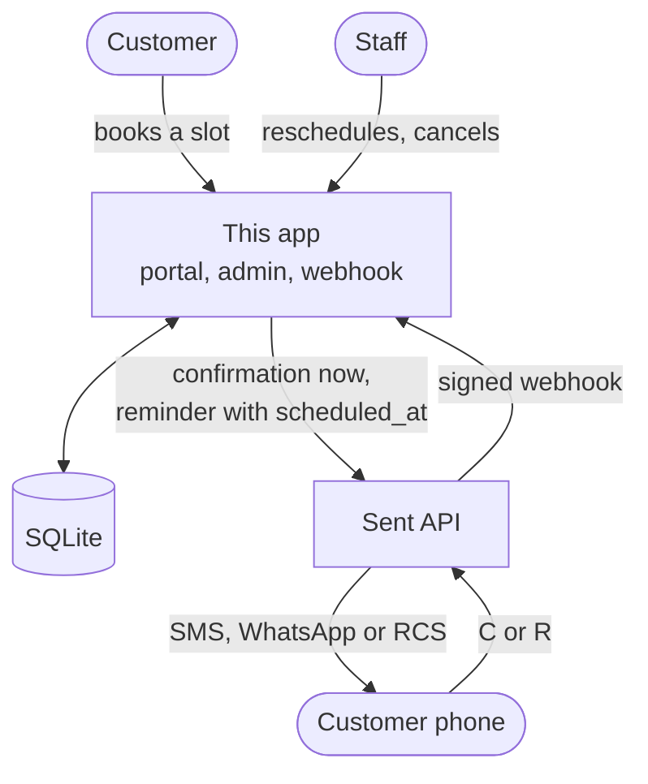
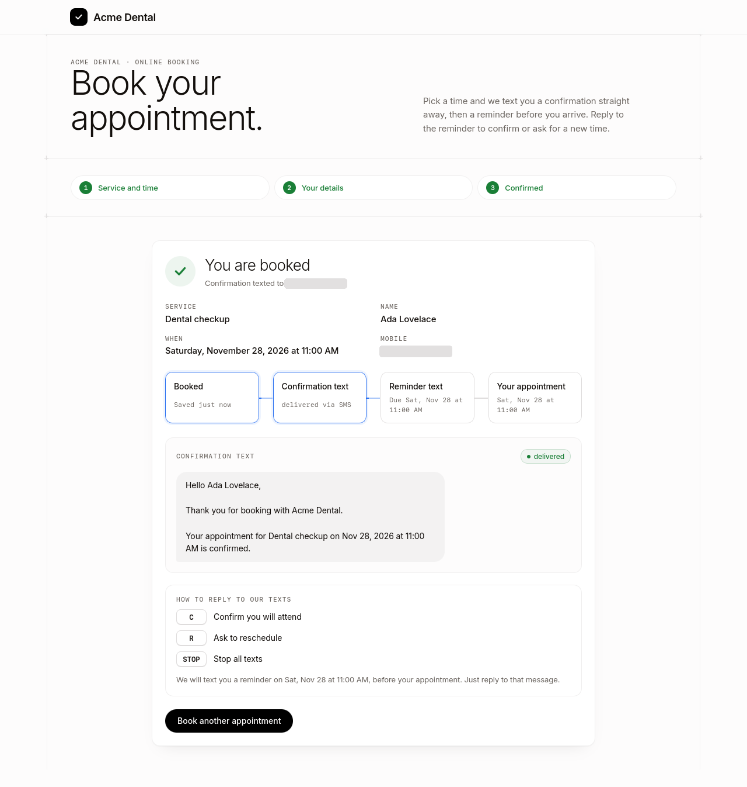
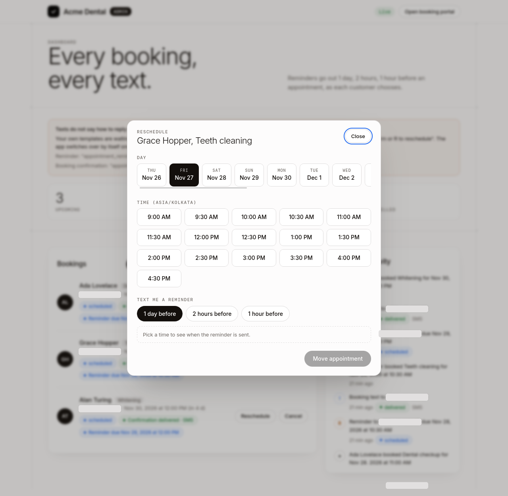
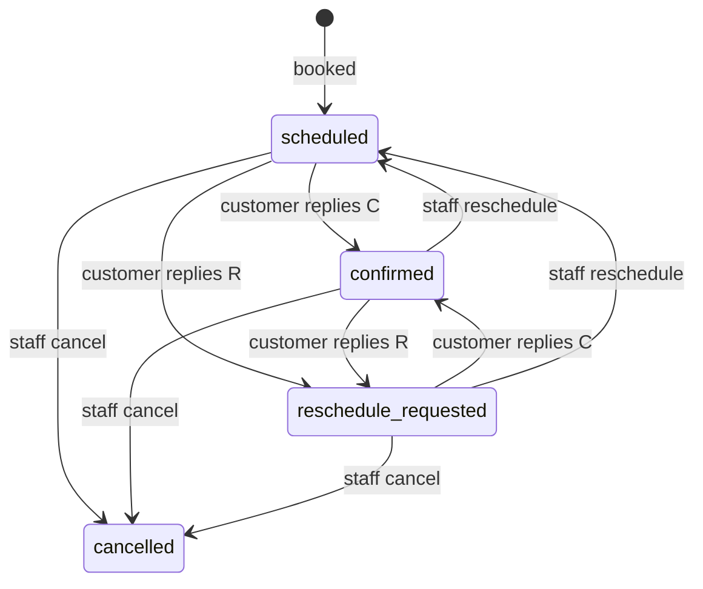

<p align="center">
  
</p>

# Appointment Reminders with Reply Handling (Sent)

A booking portal and admin dashboard for appointment businesses, built on the [Sent](https://sent.dm) API. Customers pick a slot online and get a confirmation text straight away. Sent holds a reminder and sends it before the appointment, on the channel that suits the customer. The customer answers with `C` to confirm or `R` to ask for a new time, and the booking updates itself. Use it as a starter for a clinic, salon or repair shop, or as a reference for a real Sent integration: scheduled sends, delivery tracking, signed webhooks, safe retries and readable errors.

<p>
  <a href="https://github.com/parv15/sent-appointment-reminders/actions/workflows/ci.yml"></a>
  
  
  
  
</p>

## The problem

A no-show costs an appointment business the slot and the revenue. The usual fix is a reminder text, but a reminder that only goes one way leaves staff guessing. Most examples also stop at "send an SMS": they rely on a job that polls the database every minute, never tell you whether the message arrived, and cannot handle a customer who writes back.

## What this repo solves

| Problem | How this repo handles it |
| --- | --- |
| Customers forget, and staff cannot tell who is coming | The customer replies `C` to confirm or `R` to reschedule. Bookings that asked for a new time, or have not answered close to the appointment, are flagged for staff |
| A reminder job that polls every minute | None needed. The reminder is created at booking time with Sent's `scheduled_at`, and Sent releases it |
| A reminder and a confirmation arriving together | The customer chooses when the reminder goes out, for example 1 day or 2 hours before. A reminder that would already be in the past cannot be chosen |
| No idea whether a text arrived | Every text has a live status and the channel it used, from webhooks and from polling Sent |
| Customers who ask to move the appointment | Staff reschedule in one dialog. The old reminder is cancelled, the new one scheduled and the customer is told |
| Duplicate texts after a retry | Reminders and confirmations carry idempotency keys derived from the booking |
| Setup that stalls on template approval | The app falls back to Sent's approved templates and switches to yours the moment they are approved |
| Fake or replayed webhooks | HMAC signature check in constant time, a five-minute replay window and event de-duplication |

**Contents:** [Demo](#demo) · [How it works](#how-it-works) · [Features](#features) · [Stack](#stack) · [Prerequisites](#prerequisites) · [Quick start](#quick-start) · [Screenshots](#screenshots) · [When the reminder is sent](#when-the-reminder-is-sent) · [Replies and status](#replies-and-status) · [Key integration points](#key-integration-points) · [Failure behavior](#failure-behavior) · [Security design](#security-design) · [Configuration](#configuration) · [API](#api) · [Project layout](#project-layout) · [Deploying](#deploying) · [FAQ](#faq) · [Contributing](#contributing)

## Demo

<p align="center">
  
</p>

The booking flow, then the admin dashboard. The frames are screenshots of a real run against a Sent account, with phone numbers masked.

## How it works

One Node process serves the booking portal, the admin dashboard and the webhook endpoint. Bookings are stored in a local SQLite file. Everything that touches a phone goes through Sent.



| Part | What it does | Where |
| --- | --- | --- |
| Portal | Service, day, time and reminder choice, details, confirmation with live message progress | `public/` |
| Admin | Stats, bookings, needs-attention flags, reschedule dialog, activity feed | `admin/` |
| Booking logic | Reminder timing, booking, rescheduling, cancelling, replies, status sync | `src/reminders.ts` |
| Messenger | The only code that calls the Sent SDK, with template fallback | `src/messenger.ts` |
| Webhook | Verifies signatures and applies message events | `src/app.ts`, `src/signature.ts` |
| Slots | Business hours and open slots, timezone aware | `src/slots.ts` |
| Storage | Bookings and processed webhook events | `src/store.ts` |

<p align="center">
  
</p>

1. The customer picks a service, day, time and reminder time on the portal and enters a name and mobile number.
2. `POST /api/bookings` checks that the slot is still free and that the reminder is still in the future, and saves the booking.
3. The app asks Sent to send the reminder template at the reminder time, using `scheduled_at`. Sent returns a message id.
4. The app sends the confirmation template right away. The portal shows its progress while it moves from queued to delivered.
5. Sent releases the reminder at the reminder time and delivers it on the best channel for that phone.
6. The customer replies `C` or `R`. Sent posts a `message.received` webhook.
7. The app verifies the signature, updates the booking and answers on the same channel.
8. Staff see the new status on the dashboard. A booking that asked for a new time is flagged, and the Reschedule button moves it.

## Features

- **Booking portal.** Service, day and time slot in the business timezone, mobile number with country code, and a confirmation page that shows the message moving through Queued, Sent and Delivered. A refresh keeps the confirmation on screen.
- **Customer-chosen reminder time.** Options such as 1 day, 2 hours or 1 hour before. Options that would already be in the past are disabled, and the page shows the exact time the reminder will go out.
- **Reply handling.** `C` confirms, `R` asks for a new time, anything else gets instructions. `STOP` and the other compliance keywords stay with Sent.
- **Needs-attention flags.** Bookings that asked to reschedule, and bookings with no reply as the appointment gets close, are counted and highlighted for staff.
- **Rescheduling.** One dialog picks a new slot and reminder time. The old reminder is cancelled, a new one is scheduled and the customer gets a reschedule text.
- **Delivery tracking with channel.** Every confirmation and reminder shows its status and whether it went by SMS, WhatsApp or RCS.
- **Template fallback.** Preferred templates are tried first, and Sent's approved ones are used until yours are approved. The admin page says which are in use.
- **Setup scripts.** `npm run setup:templates` creates the templates and `npm run setup:webhook` registers the webhook and saves its signing secret.
- **Admin protection.** Optional password for the dashboard.

## Stack

| | |
| --- | --- |
| Runtime | Node.js 22.13 or later, TypeScript in strict mode |
| Server | Express 5 |
| Data | SQLite through `node:sqlite`, no native build step |
| Messaging | [`@sentdm/sentdm`](https://www.npmjs.com/package/@sentdm/sentdm) 0.55, the official TypeScript SDK |
| Frontend | Plain HTML, CSS and JavaScript, Inter variable font bundled |
| Tooling | GitHub Actions for typecheck and build, Dependabot, Docker |

## Prerequisites

- Node.js 22.13 or later
- A [Sent](https://app.sent.dm) account and an API key. Light onboarding is enough to start, and its approved templates are what the app uses until yours are approved
- A public HTTPS address for the webhook, only needed to receive replies. A tunnel such as [ngrok](https://ngrok.com) works while developing

## Quick start

```bash
git clone https://github.com/parv15/sent-appointment-reminders.git
cd sent-appointment-reminders
npm install
cp .env.example .env
```

Edit `.env` and set `SENT_DM_API_KEY` and `BUSINESS_NAME`. It is a good idea to begin with `SENT_SANDBOX=true`: Sent checks every request but sends nothing, so a bad phone format, a missing template or a wrong key shows up at no cost.

```bash
npm run setup:templates
npm run dev
```

The customer portal is at <http://localhost:3000> and the admin page is at <http://localhost:3000/admin/>.

To receive replies, expose the app and register the webhook:

```bash
ngrok http 3000
npm run setup:webhook -- https://YOUR-TUNNEL.ngrok-free.app
```

`setup:webhook` registers `/webhooks/sent` for message events and writes the signing secret to `.env`. Restart the app afterwards.

### What you will see in the terminal

Starting the app while your own templates are still waiting for approval:

```text
Warning: Using "sent_Appointment_Reminder_2" for reminder until "appointment_reminder_reply" is approved (it is PENDING).
Warning: Using "sent_Appointment_Confirmation_1" for booking confirmation until "appointment_confirmation_reply" is approved (it is PENDING).
Appointment reminders listening on http://localhost:3000
```

Creating the templates. A second run skips the ones that exist:

```text
$ npm run setup:templates
appointment_confirmation_reply: already exists, skipped
appointment_reminder_reply: already exists, skipped
```

Registering the webhook:

```text
$ npm run setup:webhook -- https://YOUR-TUNNEL.ngrok-free.app
Webhook registered: https://YOUR-TUNNEL.ngrok-free.app/webhooks/sent
Signing secret saved to .env as SENT_DM_WEBHOOK_SECRET
```

## Screenshots

<p align="center">
  
  
</p>
<p align="center">The customer picks a time and when the reminder goes out, then enters their details.</p>

<p align="center">
  
  
</p>
<p align="center">The confirmation shows each text moving to delivered. Staff see every booking, text and reply.</p>

<p align="center">
  
</p>
<p align="center">Rescheduling moves the booking, the reminder and tells the customer.</p>

## When the reminder is sent

Each customer chooses a reminder time from `REMINDER_OPTIONS`, which defaults to `1440,120,60` minutes: 1 day, 2 hours or 1 hour before. The portal selects the longest option that still fits and disables the ones that do not.

| The appointment is | Options the customer sees | What happens |
| --- | --- | --- |
| 3 days away | 1 day, 2 hours and 1 hour before | The reminder is scheduled at the chosen time, 1 day before by default |
| About 20 hours away | 2 hours and 1 hour before | 1 day before has already passed, so it is disabled. The default becomes 2 hours before |
| 70 minutes away | 1 hour before only | The reminder goes out 10 minutes after booking, as a scheduled message, not together with the confirmation |

The confirmation is sent at booking time. The reminder is always a separate scheduled message, never sent at the same time as the confirmation. Sent accepts `scheduled_at` from one minute to 30 days ahead. The app asks for at least two minutes and the portal offers the next 14 days, so every choice fits. Slots closer than the shortest option plus five minutes are not offered at all. The customer sees the exact reminder time on the booking page, and the dashboard lists it in each booking.

## Replies and status

| The customer sends | What happens |
| --- | --- |
| `C`, `confirm` or `confirmed` | The booking becomes `confirmed` and a confirmation text is sent back |
| `R` or `reschedule` | The booking becomes `reschedule_requested`, is flagged for staff and an acknowledgement is sent back |
| `STOP`, `HELP` or another compliance keyword | Sent handles it and the app does nothing |
| Anything else | A text asks them to reply `C` or `R` |

Matching ignores capital letters and surrounding spaces. A reply applies to the customer's next upcoming appointment, found by phone number. The answer is sent once a conversation window is open, which the customer's reply does: on SMS and RCS at once, on WhatsApp for 24 hours after their last message.



A booking is flagged **needs attention** when the customer asked to reschedule, or when the reminder was delivered, there is no reply and the appointment is less than `NO_REPLY_WARNING_HOURS` away (default 3).

Each text is `queued`, `scheduled`, `sent`, `delivered`, `failed` or `blocked`, and the dashboard shows the channel Sent used. The app learns this from the webhook when `SENT_DM_WEBHOOK_SECRET` is set, and also asks Sent about any message that has not finished, so status works before you set up a webhook.

## Key integration points

**The reminder is one scheduled call.** Sent keeps the message and releases it at `scheduled_at`. The idempotency key makes a retried booking safe ([`src/reminders.ts`](src/reminders.ts), [`src/messenger.ts`](src/messenger.ts)):

```ts
messenger.send({
  to: appointment.phone,
  template: { name: config.templateName, parameters: textParameters(appointment) },
  scheduledAt: new Date(new Date(appointment.startsAt).getTime() - lead * 60_000),
  idempotencyKey: key,
});
```

**Templates fall back until yours are approved.** `SENT_TEMPLATE_NAME` is a comma-separated list. The first `APPROVED` template wins, and approval is re-checked every five minutes ([`src/messenger.ts`](src/messenger.ts)):

```ts
const known = await templateStatuses();
return candidates.find((n) => known.get(n) === 'APPROVED') ?? candidates[0]!;
```

**Webhooks are verified before anything else happens.** The signature is an HMAC-SHA256 over `id.timestamp.body`, compared in constant time ([`src/signature.ts`](src/signature.ts)):

```ts
const key = Buffer.from(secret.replace(/^whsec_/, ''), 'base64');
const signed = `${headers.id}.${headers.timestamp}.${rawBody.toString('utf8')}`;
const expected = Buffer.from('v1,' + createHmac('sha256', key).update(signed).digest('base64'));
```

**Rescheduling cannot lose the reminder.** The new reminder is scheduled first, the old one is cancelled second, and the database changes last. If cancelling fails, the new reminder is cancelled again and the booking is left as it was ([`src/reminders.ts`](src/reminders.ts)):

```ts
const newReminderId = await scheduleReminder(moved, lead, `reminder-${id}-${start.getTime()}`);
try {
  if (current.reminderMessageId) await messenger.cancel(current.reminderMessageId);
} catch (err) {
  await messenger.cancel(newReminderId).catch(() => undefined);
  throw err;
}
```

## Failure behavior

| What goes wrong | What the app does |
| --- | --- |
| The reminder cannot be scheduled | The booking is not kept, and the customer sees a plain error |
| The confirmation text fails | The booking and reminder stay. The portal and the admin page report the failure |
| Your own templates are not approved | Sent's approved templates are used, and the admin page says so |
| No approved template at all | Startup warns, and Sent blocks the text. The booking is not affected |
| Sent rejects the API key | The app refuses to start and says which variable to fix |
| The webhook secret is missing | The webhook answers 503 and replies are ignored. Texts still go out and status is polled |
| The same webhook arrives twice | The event id is stored, so it is processed once |
| A customer replies after the appointment | Ignored. Replies only apply to upcoming appointments |
| Two people pick the same slot | The second booking is refused and the portal reloads the slots |
| Cancelling the old reminder fails during a reschedule | The new reminder is cancelled again and nothing changes |

## Security design

- Webhook signatures are verified in constant time, requests older than five minutes are rejected, and each event id is processed once.
- The admin page and every admin API sit behind `ADMIN_PASSWORD` when it is set, compared in constant time.
- The public booking endpoints return only the booking you made, found by its random id. They never list other bookings.
- Phone numbers are validated as E.164 and names against the pattern the Sent templates accept before anything is sent.
- Secrets come only from environment variables. `.env`, the database and build output are in `.gitignore`.
- There is no analytics and no third-party script. The only font is bundled with its licence.

## Configuration

All settings are environment variables, usually kept in `.env`. [`.env.example`](.env.example) is a starting point.

| Variable | Default | Description |
| --- | --- | --- |
| `SENT_DM_API_KEY` | required | API key from the Sent dashboard |
| `BUSINESS_NAME` | required | Business name used in the texts, for example `Acme Dental` |
| `SENT_DM_WEBHOOK_SECRET` | empty | Webhook signing secret, written by `setup:webhook`. Without it, replies are ignored |
| `SENT_TEMPLATE_NAME` | `appointment_reminder_reply,sent_Appointment_Reminder_2` | Reminder template list. The first `APPROVED` one is used |
| `SENT_CONFIRMATION_TEMPLATE` | `appointment_confirmation_reply,sent_Appointment_Confirmation_1` | Booking confirmation template list. Empty turns the confirmation off |
| `SENT_RESCHEDULE_TEMPLATE` | `sent_Appointment_Reschedule_1` | Text sent when staff reschedule. Empty turns it off |
| `REMINDER_OPTIONS` | `1440,120,60` | Reminder times customers can choose, in minutes before the appointment |
| `NO_REPLY_WARNING_HOURS` | `3` | Flag a booking that has not replied this long before the appointment |
| `SERVICES` | `Appointment` | Comma-separated services customers can book |
| `BUSINESS_TIMEZONE` | `UTC` | IANA timezone for business hours and for the dates in texts, for example `America/New_York` |
| `BOOKING_START_HOUR` | `9` | First bookable hour |
| `BOOKING_END_HOUR` | `17` | End of the last slot |
| `SLOT_MINUTES` | `30` | Slot length: 10, 15, 20, 30, 45 or 60 |
| `DEFAULT_COUNTRY_CODE` | `+1` | Country code preselected on the portal |
| `ADMIN_PASSWORD` | empty | Password for `/admin`, with the user name `admin` |
| `SENT_SANDBOX` | `false` | Validate requests without sending anything |
| `PORT` | `3000` | HTTP port |
| `DATABASE_PATH` | `./data/appointments.db` | SQLite file |

## API

Open endpoints used by the booking portal:

| Method | Path | Description |
| --- | --- | --- |
| `GET` | `/api/config` | Business name, services, timezone, reminder options and mode |
| `GET` | `/api/slots?date=YYYY-MM-DD` | Open slots for a day, as UTC instants |
| `POST` | `/api/bookings` | Book a slot. Body: `service`, `name`, `phone` in E.164, `startsAt` from `/api/slots`, optional `reminderMinutes` |
| `GET` | `/api/bookings/:id` | One booking, the delivery status and channel of its confirmation text |
| `POST` | `/webhooks/sent` | Receives Sent webhooks |
| `GET` | `/healthz` | Liveness check |

Admin endpoints, protected by `ADMIN_PASSWORD` when it is set:

| Method | Path | Description |
| --- | --- | --- |
| `GET` | `/admin/` | The dashboard |
| `GET` | `/api/admin/appointments` | All bookings, each with an `attention` field |
| `GET` | `/api/admin/activity` | The alerts and activity feed |
| `GET` | `/api/admin/templates` | Which templates are preferred and which are in use |
| `POST` | `/api/admin/appointments/:id/reschedule` | Move a booking. Body: `startsAt`, optional `reminderMinutes` |
| `POST` | `/api/admin/appointments/:id/cancel` | Cancel a booking and its scheduled reminder |

```bash
curl "http://localhost:3000/api/slots?date=2026-12-03"

curl -X POST http://localhost:3000/api/bookings \
  -H "Content-Type: application/json" \
  -d '{"service": "Dental checkup", "name": "Ada Lovelace", "phone": "+14155551234", "startsAt": "2026-12-03T14:30:00.000Z", "reminderMinutes": 120}'
```

## Project layout

```text
src/
  server.ts       Entry point: config, startup checks, shutdown
  app.ts          Portal, admin and webhook routes
  reminders.ts    Booking, rescheduling, cancelling, replies and status updates
  messenger.ts    The Sent SDK wrapper, with template fallback
  slots.ts        Business hours and open slots, timezone aware
  attention.ts    Which bookings need staff attention
  activity.ts     Alerts and activity feed
  signature.ts    Webhook signature verification
  replies.ts      Reply classification
  errors.ts       Turns Sent API errors into readable messages
  config.ts       Environment validation
  auth.ts         Admin basic auth
  store.ts        SQLite storage
public/           Customer portal, shared styles, slot picker, font
admin/            Admin dashboard
scripts/          setup:templates and setup:webhook
docs/             Template definitions, diagrams, screenshots
```

## Deploying

The app is one process with one SQLite file, so it fits any host that runs a container or Node.js with a persistent disk.

```bash
docker build -t appointment-reminders .
docker run -p 3000:3000 --env-file .env -v reminders-data:/app/data appointment-reminders
```

Without Docker, run `npm run build` and then `npm start`.

Before you go live:

- Set `ADMIN_PASSWORD` and serve the app over HTTPS.
- Keep the database on a persistent volume and run a single instance, because polling state is kept in memory.
- Register the webhook for your real domain with `npm run setup:webhook -- https://your-domain`.
- Messages to US numbers need 10DLC registration with Sent before they are delivered.
- If you pasted your API key anywhere it should not be, rotate it first.

## FAQ

**Why are the texts missing "Reply C to confirm or R to reschedule"?** The reply wording lives in the templates, and Sent has to approve a template before it can be used. Until yours are approved, the app uses Sent's standard ones, which do not include it. The booking page tells customers how to reply in the meantime, and the admin page shows a notice. When your templates become `APPROVED` the app switches on its own within five minutes.

**Can I change the reminder wording?** Yes. Edit the JSON files in [`docs/templates`](docs/templates), create new templates with `npm run setup:templates`, and put their names first in `SENT_TEMPLATE_NAME` and `SENT_CONFIRMATION_TEMPLATE`. The variable names must match the ones used in [`src/reminders.ts`](src/reminders.ts).

**Does it work without a webhook?** Bookings, confirmations, reminders and delivery status all work. Customer replies need the webhook, because that is how Sent hands them to the app.

**What does sandbox mode do?** Sent validates each request and sends nothing. Responses are sample data, so reading a sandbox message back returns 404, and the app skips status polling. If you leave it on in production, Sent still answers 202 but never delivers, so check the mode badge at the top of the page.

**Why only one instance?** Bookings are in a SQLite file and the status polling state is in memory. Two instances would each poll, and the file cannot be shared safely over a network disk.

**Can customers book several appointments?** Yes. A reply is applied to the customer's next upcoming appointment, found by phone number.

## Contributing

Issues and pull requests are welcome. [CONTRIBUTING.md](CONTRIBUTING.md) lists the checks to run first.

## License

[MIT](LICENSE)
