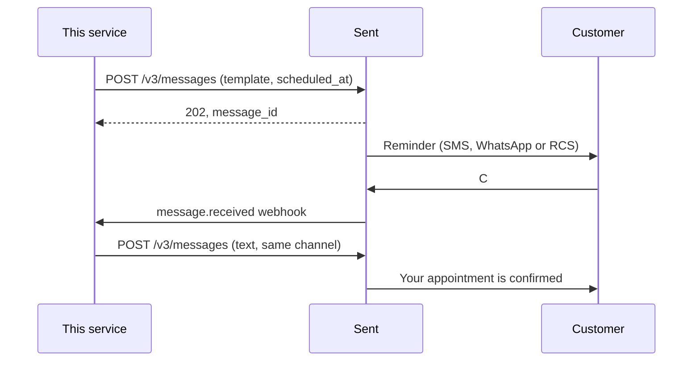

# Appointment reminders with reply handling

Schedule appointment reminders on [Sent](https://sent.dm) and let customers answer from their phone. A reply of **C** confirms, **R** asks to reschedule, and every reply is answered on the channel it arrived on.

TypeScript, Express 5, SQLite. No queue and no cron: Sent holds the reminder and releases it at the right time.



## Try it in 30 seconds

No Sent account needed. Demo mode simulates Sent locally and gives you a fake customer phone next to the booking screen.

```bash
npm install
npm run demo
```

Open <http://localhost:3000>, then:

1. Book an appointment. The reminder appears on the phone as scheduled.
2. Click **Deliver now** on the scheduled message, which stands in for Sent releasing it at the reminder time.
3. Reply **C**. The status becomes `confirmed` and a confirmation arrives.
4. Book another and reply **R**, `hello` or `STOP` to see the other paths.

Demo data lives in memory and is gone on restart.

## How it works

1. **Book.** `POST /api/appointments` stores the appointment and calls Sent to send the template, with `scheduled_at` set to the appointment time minus `REMINDER_LEAD_MINUTES`. Sent returns a message id, which is saved on the appointment.
2. **Remind.** Sent holds the message and releases it at that time on the channel it picks for the contact (SMS, WhatsApp or RCS).
3. **Track.** Sent posts `message.*` events to `/webhooks/sent`. Each one is signature-checked, then the reminder status updates (`delivered`, `failed`, `blocked`).
4. **Reply.** A customer reply arrives as `message.received`. `C` marks the appointment `confirmed`, `R` marks it `reschedule_requested`, other text gets a help message. The answer is sent back on the same channel.
5. **Cancel.** Cancelling an appointment calls Sent to cancel the held reminder, and later replies are ignored.

Real mode is the same flow with your Sent account. See [Setup](#setup).

## Features

- Reminder sent a configurable time before the appointment, scheduled with `scheduled_at`
- Channel picked per recipient by Sent, with its built-in fallback
- Reply handling: `C` confirm, `R` reschedule, anything else gets instructions
- Status tracking from delivery webhooks
- Cancelling an appointment cancels the scheduled reminder
- Signed webhook verification with replay protection and event deduplication
- Small web UI to book, watch statuses and cancel

## Requirements

- Node.js 22.13 or later
- A Sent account and API key
- An approved reminder template (below)
- A public HTTPS URL for webhooks. Use a tunnel such as ngrok while developing

## Setup

### 1. Create the template

In the Sent dashboard, create a template named `appointment_reminder` with three variables and submit it for review:

```
Hi {{name}}, this is a reminder of your appointment on {{date}} at {{time}}. Reply C to confirm or R to reschedule.
```

WhatsApp templates go through Meta review and RCS templates through the RCS sender profile. Sent reports approval changes by webhook.

### 2. Configure

```bash
npm install
cp .env.example .env
```

| Variable | Default | Description |
| --- | --- | --- |
| `SENT_DM_API_KEY` | required | API key from the Sent dashboard |
| `SENT_DM_WEBHOOK_SECRET` | required | Signing secret returned when you register the webhook |
| `SENT_TEMPLATE_NAME` | `appointment_reminder` | Template used for reminders |
| `REMINDER_LEAD_MINUTES` | `1440` | How long before the appointment the reminder goes out |
| `BUSINESS_TIMEZONE` | `UTC` | IANA timezone used to format the date and time in messages |
| `SENT_SANDBOX` | `false` | Validate requests without sending anything |
| `PORT` | `3000` | HTTP port |
| `DATABASE_PATH` | `./data/appointments.db` | SQLite file |

### 3. Register the webhook

Expose the service, then register it for `message` events:

```bash
ngrok http 3000

curl -X POST https://api.sent.dm/v3/webhooks \
  -H "x-api-key: $SENT_DM_API_KEY" \
  -H "Content-Type: application/json" \
  -d '{
    "display_name": "Appointment reminders",
    "endpoint_url": "https://YOUR-TUNNEL.ngrok.io/webhooks/sent",
    "event_types": ["message"]
  }'
```

Copy `signing_secret` from the response into `SENT_DM_WEBHOOK_SECRET`.

### 4. Run

```bash
npm run dev
```

Open <http://localhost:3000>.

For production: `npm run build && npm start`.

## API

| Method | Path | Description |
| --- | --- | --- |
| `POST` | `/api/appointments` | Book an appointment and schedule its reminder |
| `GET` | `/api/appointments` | List appointments |
| `POST` | `/api/appointments/:id/cancel` | Cancel an appointment and its scheduled reminder |
| `POST` | `/webhooks/sent` | Sent webhook receiver |
| `GET` | `/healthz` | Liveness |

```bash
curl -X POST http://localhost:3000/api/appointments \
  -H "Content-Type: application/json" \
  -d '{"name": "Ada", "phone": "+14155551234", "startsAt": "2026-12-03T15:00:00-05:00"}'
```

`phone` is E.164. `startsAt` is ISO-8601 with a UTC offset.

## Behavior to know

- **Scheduling window.** Sent accepts `scheduled_at` between one minute and 30 days ahead. If the reminder time is less than two minutes away, the reminder is sent immediately. If it is more than 30 days away, the booking is rejected.
- **Replies.** Matching is on the whole trimmed text, case-insensitive. Compliance keywords such as `STOP` and `HELP` are handled by Sent and ignored here. A reply is applied to the contact's next upcoming appointment.
- **Free-form replies need an open window.** On SMS and RCS once the contact has replied, on WhatsApp for 24 hours after their last message. A reply that is blocked shows up as a `message.blocked` event.
- **Retries are safe.** The reminder uses an idempotency key derived from the appointment, and webhook events are deduplicated on their event id.
- **Sandbox.** `SENT_SANDBOX=true` validates requests but delivers nothing, and follow-up reads of sandbox message ids return 404. Left on in production, sends return 202 and are dropped.
- **US SMS** requires 10DLC registration before messages are delivered.

## Project layout

```
src/
  app.ts         HTTP routes and webhook endpoint
  reminders.ts   booking, cancelling and reply logic
  messenger.ts   thin wrapper over the Sent SDK
  demo.ts        local Sent simulator for demo mode
  signature.ts   webhook signature verification
  replies.ts     reply classification
  store.ts       SQLite storage
  server.ts      entry point
public/          booking UI
```

## License

MIT
