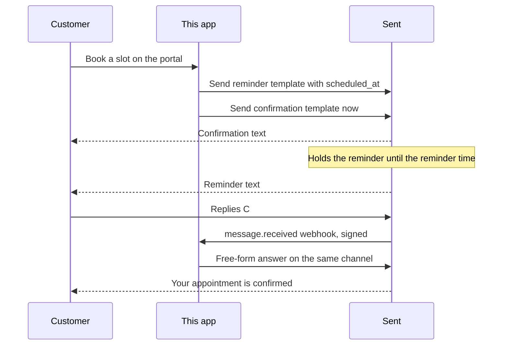
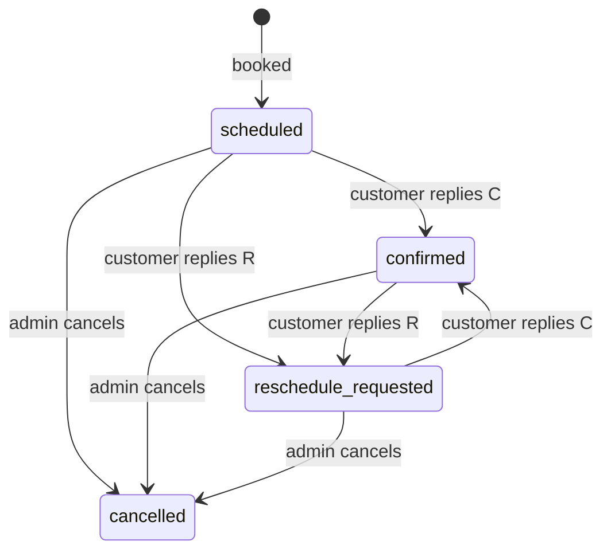

<div align="center">

# Appointment reminders with reply handling

**Online booking, an instant confirmation text, a scheduled reminder, and one-letter replies, built on [Sent](https://sent.dm).**

[](https://github.com/parv15/sent-appointment-reminders/actions/workflows/ci.yml)
[](https://nodejs.org)
[](https://www.typescriptlang.org)
[](https://www.npmjs.com/package/@sentdm/sentdm)
[](LICENSE)


</div>

## What it does

No-shows cost appointment businesses real money. This app is a small, complete example of the fix:

1. A customer books a slot on a **booking portal**.
2. They instantly get a **confirmation text**.
3. Sent holds a **reminder** and sends it a set time before the appointment, on the channel that suits the customer (SMS, WhatsApp or RCS).
4. The customer replies **`C`** to confirm or **`R`** to ask for a new time. The status updates and they get an answer.
5. The business watches everything on an **admin dashboard**: bookings, delivery status of every text, replies, and cancellations.

There is no queue and no cron job. Sent's `scheduled_at` does the waiting, and a webhook brings the replies back.

It is a reference implementation for developers building on Sent: a typed SDK client, scheduled sends, per-message status tracking, signed webhooks, idempotent retries and friendly error handling, in about 1,100 lines of TypeScript.

## Screenshots

<table>
  <tr>
    <td width="33%"></td>
    <td width="33%"></td>
    <td width="33%"></td>
  </tr>
  <tr>
    <td align="center"><b>1. Pick a time</b></td>
    <td align="center"><b>2. Your details</b></td>
    <td align="center"><b>3. Booked, text delivered</b></td>
  </tr>
</table>

## Quick start (no Sent account needed)

Demo mode simulates Sent locally and adds a fake customer phone to the admin page, so you can try the whole flow in a minute.

```bash
git clone https://github.com/parv15/sent-appointment-reminders.git
cd sent-appointment-reminders
npm install
npm run demo
```

| Page | URL |
| --- | --- |
| Customer booking portal | <http://localhost:3000> |
| Admin dashboard | <http://localhost:3000/admin/> |

Try this:

1. On the portal, pick a service, day and time, enter a name and number, and confirm. You see the booking and the text the customer receives.
2. Open the admin page. The booking, the confirmation alert and the scheduled reminder are listed.
3. In the phone panel, click **Deliver now** on the reminder. This stands in for Sent releasing it at the reminder time.
4. Reply **C**. The booking turns `confirmed` and a confirmation text arrives. Try **R**, `hello` and `STOP` on other bookings.

Make the demo look like your business:

```bash
BUSINESS_NAME="Acme Dental" SERVICES="Dental checkup,Teeth cleaning" npm run demo
```

Demo data lives in memory and disappears on restart.

## How it works



### When is the reminder sent?

`REMINDER_LEAD_MINUTES` sets how long before the appointment the reminder goes out. The default is `1440`, which is 24 hours.

| Appointment is | With `REMINDER_LEAD_MINUTES=1440` | What the app does |
| --- | --- | --- |
| 3 days away | Reminder due in 2 days | Asks Sent to send it then, using `scheduled_at` |
| 20 hours away | Reminder time already passed | Sends it right away |
| Reminder time under 2 minutes away | Too close for Sent to schedule | Sends it right away |

Sent accepts `scheduled_at` between one minute and 30 days ahead. The portal only offers the next 14 days, so a booking always fits. The customer sees the exact reminder time on the booking page, and the admin page shows it in the feed.

### Appointment status



### Replies

| Customer sends | Result |
| --- | --- |
| `C`, `confirm`, `confirmed` | Status `confirmed`, confirmation text sent back |
| `R`, `reschedule` | Status `reschedule_requested`, acknowledgement sent back |
| `STOP`, `HELP` and the other compliance keywords | Handled by Sent. The app does nothing |
| Anything else | A text reminding them to reply `C` or `R` |

Matching ignores case and surrounding spaces. A reply applies to the customer's next upcoming appointment, found by phone number. Delivery of the answer needs an open conversation window, which a customer reply opens: on SMS and RCS once they reply, on WhatsApp for 24 hours after their last message.

### Delivery status

Every text has a status: `queued`, `scheduled`, `sent`, `delivered`, `failed` or `blocked`. The app learns it two ways, so it works before you set up a webhook:

- Sent webhooks, when `SENT_DM_WEBHOOK_SECRET` is set.
- Polling Sent for any message that has not reached a final state.

## Run it with your Sent account

You need Node.js 22.13 or later and a [Sent](https://app.sent.dm) account. Light onboarding is enough to start.

### 1. Create the templates

Sent sends the confirmation and the reminder from approved templates. Create two with the files in [`docs/templates`](docs/templates):

```bash
export SENT_DM_API_KEY=your_api_key

curl -X POST https://api.sent.dm/v3/templates \
  -H "x-api-key: $SENT_DM_API_KEY" -H "Content-Type: application/json" \
  -d @docs/templates/appointment_reminder_reply.json

curl -X POST https://api.sent.dm/v3/templates \
  -H "x-api-key: $SENT_DM_API_KEY" -H "Content-Type: application/json" \
  -d @docs/templates/appointment_confirmation_reply.json
```

Both are submitted for review. WhatsApp templates go through Meta review and RCS templates through the RCS sender profile, so approval can take time. Until they are approved, the app falls back to the templates every Sent account already has, `sent_Appointment_Reminder_2` and `sent_Appointment_Confirmation_1`. Those texts have no reply instructions, so the booking page also shows customers how to reply. The app checks every five minutes and switches to yours once they are `APPROVED`.

### 2. Configure

```bash
cp .env.example .env
```

Set at least `SENT_DM_API_KEY` and `BUSINESS_NAME`. Start with `SENT_SANDBOX=true`: Sent validates every request without sending anything, so a wrong phone format, a missing template or a bad key shows up safely.

### 3. Register the webhook (for replies)

Replies come back through a webhook, so Sent must reach your server over HTTPS. While developing, use a tunnel such as [ngrok](https://ngrok.com):

```bash
ngrok http 3000

curl -X POST https://api.sent.dm/v3/webhooks \
  -H "x-api-key: $SENT_DM_API_KEY" -H "Content-Type: application/json" \
  -d '{
    "display_name": "Appointment reminders",
    "endpoint_url": "https://YOUR-TUNNEL.ngrok-free.app/webhooks/sent",
    "event_types": ["message"]
  }'
```

Put the returned `signing_secret` in `SENT_DM_WEBHOOK_SECRET`. Without it the app still sends and tracks texts, and warns at startup that replies are ignored.

### 4. Run

```bash
npm install
npm run dev
```

For production, build once and start:

```bash
npm run build
npm start
```

## Configuration

Set these in `.env`. See [`.env.example`](.env.example) for a starting point.

| Variable | Default | Description |
| --- | --- | --- |
| `SENT_DM_API_KEY` | required | API key from the Sent dashboard |
| `BUSINESS_NAME` | required | Business name used in the texts, for example `Acme Dental` |
| `SENT_DM_WEBHOOK_SECRET` | empty | Webhook signing secret. Without it, customer replies are ignored |
| `SENT_TEMPLATE_NAME` | `appointment_reminder_reply,sent_Appointment_Reminder_2` | Reminder template. A comma-separated list: the first `APPROVED` one is used |
| `SENT_CONFIRMATION_TEMPLATE` | `appointment_confirmation_reply,sent_Appointment_Confirmation_1` | Booking confirmation template, same list rule. Set empty to turn the confirmation off |
| `REMINDER_LEAD_MINUTES` | `1440` | How long before the appointment the reminder goes out |
| `SERVICES` | `Appointment` | Comma-separated services customers can book |
| `BUSINESS_TIMEZONE` | `UTC` | IANA timezone for business hours and for dates in texts, for example `America/New_York` |
| `BOOKING_START_HOUR` | `9` | First bookable hour |
| `BOOKING_END_HOUR` | `17` | End of the last slot |
| `SLOT_MINUTES` | `30` | Slot length: 10, 15, 20, 30, 45 or 60 |
| `DEFAULT_COUNTRY_CODE` | `+1` | Country code preselected on the portal |
| `ADMIN_PASSWORD` | empty | Protects `/admin` with HTTP basic auth, user `admin`. Set it before exposing the server |
| `SENT_SANDBOX` | `false` | Validate requests without sending anything |
| `DEMO_MODE` | `false` | Simulate Sent locally. Set by `npm run demo` |
| `PORT` | `3000` | HTTP port |
| `DATABASE_PATH` | `./data/appointments.db` | SQLite file |

## API

Public, used by the booking portal:

| Method | Path | Description |
| --- | --- | --- |
| `GET` | `/api/config` | Business name, services, timezone and mode |
| `GET` | `/api/slots?date=YYYY-MM-DD` | Open slots for a day, as UTC instants |
| `POST` | `/api/bookings` | Book a slot. Body: `service`, `name`, `phone` (E.164), `startsAt` (a slot from `/api/slots`) |
| `GET` | `/api/bookings/:id` | One booking and the delivery status of its confirmation text |
| `POST` | `/webhooks/sent` | Sent webhook receiver |
| `GET` | `/healthz` | Liveness |

Admin, behind `ADMIN_PASSWORD` when it is set:

| Method | Path | Description |
| --- | --- | --- |
| `GET` | `/admin/` | Dashboard |
| `GET` | `/api/admin/appointments` | All bookings |
| `GET` | `/api/admin/activity` | Alerts and activity feed |
| `POST` | `/api/admin/appointments/:id/cancel` | Cancel a booking and its scheduled reminder |

```bash
curl "http://localhost:3000/api/slots?date=2026-12-03"

curl -X POST http://localhost:3000/api/bookings \
  -H "Content-Type: application/json" \
  -d '{"service": "Dental checkup", "name": "Ada Lovelace", "phone": "+14155551234", "startsAt": "2026-12-03T14:30:00.000Z"}'
```

## Project layout

```
src/
  server.ts       Entry point: config, startup checks, shutdown
  app.ts          Portal, admin and webhook routes
  reminders.ts    Booking, cancelling, reply and status logic
  messenger.ts    Thin wrapper over the Sent SDK, with template fallback
  demo.ts         Local Sent simulator for demo mode
  slots.ts        Business hours and open slots, timezone aware
  signature.ts    Webhook signature verification
  replies.ts      Reply classification
  activity.ts     Alerts and activity feed
  errors.ts       Sent API errors turned into readable messages
  config.ts       Environment validation
  auth.ts         Admin basic auth
  store.ts        SQLite storage
public/           Customer booking portal
admin/            Admin dashboard
docs/             Template definitions and screenshots
```

## Good to know

- **Webhooks are verified.** Signatures are checked with HMAC-SHA256 over `id.timestamp.body` in constant time, requests older than five minutes are rejected, and each event id is processed once.
- **Retries are safe.** The reminder and the confirmation each use an idempotency key derived from the booking.
- **Cancelling** a booking cancels the reminder Sent is holding, and frees the slot.
- **Sandbox.** Sandbox responses are sample data, so reading a sandbox message back returns 404, and the app skips status polling in sandbox mode. A sandbox flag left on in production drops messages while Sent still answers 202.
- **US numbers** need 10DLC registration before SMS is delivered.
- **Single instance.** Bookings live in a local SQLite file and status polling state in memory. Run one instance, with the database on a persistent disk.
- **Before going public:** set `ADMIN_PASSWORD`, serve over HTTPS, and rotate any API key you have pasted anywhere.

## Troubleshooting

| You see | Cause and fix |
| --- | --- |
| `Cannot start, fix the configuration` | A variable is missing or invalid. Each problem is listed. Compare `.env` with `.env.example` |
| `Sent rejected the API key` | `SENT_DM_API_KEY` is wrong or revoked. Create a new key in the dashboard |
| `No approved template for reminders` | Neither template in the list is `APPROVED`. Finish step 1 or point `SENT_TEMPLATE_NAME` at an approved template |
| `Sent rejected the request: Invalid phone number format` | The number must be E.164, for example `+14155551234`. The portal builds it from the country code |
| Texts go out but replies do nothing | `SENT_DM_WEBHOOK_SECRET` is unset, or Sent cannot reach your webhook URL. Redo step 3 |
| Webhook returns 401 | Wrong signing secret, or the server clock is more than five minutes off |
| `Port 3000 is already in use` | Set `PORT` to another value |

## License

[MIT](LICENSE)
