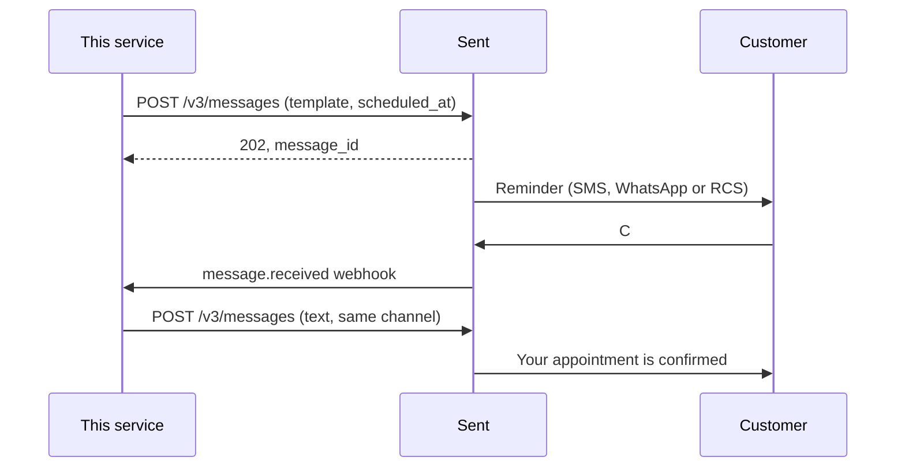

# Appointment reminders with reply handling

Schedule appointment reminders on [Sent](https://sent.dm) and let customers answer from their phone. A reply of **C** confirms, **R** asks to reschedule, and every reply is answered on the channel it arrived on.

TypeScript, Express 5, SQLite. No queue and no cron: Sent holds the reminder and releases it at the right time.



## Try it in 30 seconds

No Sent account needed. Demo mode simulates Sent locally and gives you a fake customer phone next to the booking screen.

```bash
npm install
npm run demo
```

Two pages:

- <http://localhost:3000> is the customer booking portal.
- <http://localhost:3000/admin/> is the admin dashboard, with a simulated customer phone.

Then:

1. On the portal, pick a service, a day and a time, enter a name and mobile number, and confirm. The page shows the booking and the text message the customer gets.
2. Open the admin page. The booking, the alert and the scheduled reminder are listed.
3. In the phone panel, click **Deliver now** on a scheduled reminder, which stands in for Sent releasing it at the reminder time.
4. Reply **C**. The status becomes `confirmed` and a confirmation arrives. Try **R**, `hello` and `STOP` on other bookings.

Demo data lives in memory and is gone on restart.

## How it works

1. **Book.** `POST /api/appointments` stores the appointment, sends the customer a booking alert right away, and calls Sent to schedule the reminder template, with `scheduled_at` set to the appointment time minus `REMINDER_LEAD_MINUTES`. Sent returns a message id, which is saved on the appointment.
2. **Remind.** Sent holds the message and releases it at that time on the channel it picks for the contact (SMS, WhatsApp or RCS).
3. **Track.** Sent posts `message.*` events to `/webhooks/sent`. Each one is signature-checked, then the reminder status updates (`delivered`, `failed`, `blocked`).
4. **Reply.** A customer reply arrives as `message.received`. `C` marks the appointment `confirmed`, `R` marks it `reschedule_requested`, other text gets a help message. The answer is sent back on the same channel.
5. **Cancel.** Cancelling an appointment calls Sent to cancel the held reminder, and later replies are ignored.

Real mode is the same flow with your Sent account. See [Setup](#setup).

## Features

- Reminder sent a configurable time before the appointment, scheduled with `scheduled_at`
- Channel picked per recipient by Sent, with its built-in fallback
- Reply handling: `C` confirm, `R` reschedule, anything else gets instructions
- Status tracking from delivery webhooks
- Cancelling an appointment cancels the scheduled reminder
- Signed webhook verification with replay protection and event deduplication
- Customer booking portal: service, day and time slot, details, then a confirmation with live delivery status of the text message
- Admin dashboard: stats, filterable bookings, an alerts and activity feed, cancel, optional password

## Requirements

- Node.js 22.13 or later
- A Sent account and API key. Light onboarding is enough to start
- An approved reminder template (below)
- A public HTTPS URL for webhooks, only needed to receive replies and delivery updates. Use a tunnel such as ngrok while developing

Built on [`@sentdm/sentdm`](https://www.npmjs.com/package/@sentdm/sentdm) 0.55, the official TypeScript SDK, with Express 5 as in Sent's Express guide.

## Setup

### 1. Create the template

Create a template named `appointment_reminder_reply` and submit it for review. Through the API:

```bash
curl -X POST https://api.sent.dm/v3/templates \
  -H "x-api-key: $SENT_DM_API_KEY" \
  -H "Content-Type: application/json" \
  -d '{
    "name": "appointment_reminder_reply",
    "category": "UTILITY",
    "language": "en_US",
    "submit_for_review": true,
    "definition": {
      "body": {
        "multiChannel": {
          "type": "text",
          "template": "Hello {{0:variable}},\n\nThis is a reminder about your upcoming appointment with {{1:variable}} on {{2:variable}} at {{3:variable}}.\n\nReply C to confirm or R to reschedule.",
          "variables": [
            { "id": 0, "name": "customer_name", "type": "variable", "props": { "variableType": "text", "sample": "John" } },
            { "id": 1, "name": "business_name", "type": "variable", "props": { "variableType": "text", "sample": "Fashion Styles" } },
            { "id": 2, "name": "appointment_date", "type": "variable", "props": { "variableType": "text", "sample": "December 31, 2025" } },
            { "id": 3, "name": "appointment_time", "type": "variable", "props": { "variableType": "text", "sample": "1:00 PM" } }
          ]
        }
      },
      "definitionVersion": "1.0"
    }
  }'
```

WhatsApp templates go through Meta review and RCS templates through the RCS sender profile. The app warns at startup while the template is not `APPROVED`.

Want to start before approval? Every Sent account has the approved template `sent_Appointment_Reminder_2`, which takes the same four variables. Set `SENT_TEMPLATE_NAME=sent_Appointment_Reminder_2`. It has no "Reply C or R" line, so customers will not know to reply.

### 2. Configure

```bash
npm install
cp .env.example .env
```

| Variable | Default | Description |
| --- | --- | --- |
| `SENT_DM_API_KEY` | required | API key from the Sent dashboard |
| `BUSINESS_NAME` | required | Business name shown in the reminder, for example `Acme Dental` |
| `SENT_DM_WEBHOOK_SECRET` | empty | Signing secret from step 3. Without it, customer replies are ignored. Delivery status is still tracked by polling Sent |
| `SENT_TEMPLATE_NAME` | `appointment_reminder_reply` | Template used for reminders |
| `SENT_CONFIRMATION_TEMPLATE` | `sent_Appointment_Confirmation_1` | Template for the alert sent the moment an appointment is booked. Set empty to turn the alert off |
| `SERVICES` | `Appointment` | Comma-separated services customers can book, for example `Dental checkup,Teeth cleaning` |
| `DEFAULT_COUNTRY_CODE` | `+1` | Country code preselected on the portal |
| `BOOKING_START_HOUR` / `BOOKING_END_HOUR` | `9` / `17` | Bookable hours in `BUSINESS_TIMEZONE` |
| `SLOT_MINUTES` | `30` | Slot length: 10, 15, 20, 30, 45 or 60 |
| `ADMIN_PASSWORD` | empty | Protects `/admin` with HTTP basic auth (user `admin`). Set it before exposing the server |
| `REMINDER_LEAD_MINUTES` | `1440` | How long before the appointment the reminder goes out |
| `BUSINESS_TIMEZONE` | `UTC` | IANA timezone used to format the date and time in messages |
| `SENT_SANDBOX` | `false` | Validate requests without sending anything |
| `PORT` | `3000` | HTTP port |
| `DATABASE_PATH` | `./data/appointments.db` | SQLite file |

Start with `SENT_SANDBOX=true`. The app validates every request against the real Sent API, so wrong phone formats, missing templates and bad keys show up without sending anything.

### 3. Register the webhook

Expose the service, then register it for `message` events:

```bash
ngrok http 3000

curl -X POST https://api.sent.dm/v3/webhooks \
  -H "x-api-key: $SENT_DM_API_KEY" \
  -H "Content-Type: application/json" \
  -d '{
    "display_name": "Appointment reminders",
    "endpoint_url": "https://YOUR-TUNNEL.ngrok.io/webhooks/sent",
    "event_types": ["message"]
  }'
```

Copy `signing_secret` from the response into `SENT_DM_WEBHOOK_SECRET`.

### 4. Run

```bash
npm run dev
```

Open <http://localhost:3000> for the portal and <http://localhost:3000/admin/> for the dashboard.

For production: `npm run build && npm start`.

## API

Public, used by the portal:

| Method | Path | Description |
| --- | --- | --- |
| `GET` | `/api/config` | Business name, services, timezone and mode |
| `GET` | `/api/slots?date=YYYY-MM-DD` | Open slots for a day, as UTC instants |
| `POST` | `/api/bookings` | Book a slot. Body: `service`, `name`, `phone` (E.164), `startsAt` (a slot from `/api/slots`) |
| `GET` | `/api/bookings/:id` | One booking and the delivery status of its alert |
| `POST` | `/webhooks/sent` | Sent webhook receiver |
| `GET` | `/healthz` | Liveness |

Admin, behind `ADMIN_PASSWORD` when set:

| Method | Path | Description |
| --- | --- | --- |
| `GET` | `/admin/` | Dashboard |
| `GET` | `/api/admin/appointments` | All bookings |
| `GET` | `/api/admin/activity` | Alerts and activity feed |
| `POST` | `/api/admin/appointments/:id/cancel` | Cancel a booking and its scheduled reminder |

```bash
curl -s "http://localhost:3000/api/slots?date=2026-12-03"
curl -X POST http://localhost:3000/api/bookings \
  -H "Content-Type: application/json" \
  -d '{"service": "Dental checkup", "name": "Ada Lovelace", "phone": "+14155551234", "startsAt": "2026-12-03T14:30:00.000Z"}'
```

## Behavior to know

- **Scheduling window.** Sent accepts `scheduled_at` between one minute and 30 days ahead. If the reminder time is less than two minutes away, the reminder is sent immediately. If it is more than 30 days away, the booking is rejected.
- **Replies.** Matching is on the whole trimmed text, case-insensitive. Compliance keywords such as `STOP` and `HELP` are handled by Sent and ignored here. A reply is applied to the contact's next upcoming appointment.
- **Free-form replies need an open window.** On SMS and RCS once the contact has replied, on WhatsApp for 24 hours after their last message. A reply that is blocked shows up as a `message.blocked` event.
- **Retries are safe.** The reminder uses an idempotency key derived from the appointment, and webhook events are deduplicated on their event id.
- **Sandbox.** `SENT_SANDBOX=true` validates requests but delivers nothing, and follow-up reads of sandbox message ids return 404. Left on in production, sends return 202 and are dropped.
- **US SMS** requires 10DLC registration before messages are delivered.

## Project layout

```
src/
  app.ts         portal, admin and webhook routes
  slots.ts       business hours and open slots
  activity.ts    alerts and activity feed
  auth.ts        admin basic auth
  reminders.ts   booking, cancelling and reply logic
  config.ts      environment validation
  errors.ts      Sent API errors turned into readable messages
  messenger.ts   thin wrapper over the Sent SDK
  demo.ts        local Sent simulator for demo mode
  signature.ts   webhook signature verification
  replies.ts     reply classification
  store.ts       SQLite storage
  server.ts      entry point
public/          customer booking portal
admin/           admin dashboard
```

## Troubleshooting

| Message | Cause and fix |
| --- | --- |
| `Cannot start, fix the configuration` | A variable is missing or invalid. Each problem is listed. Check `.env` against `.env.example` |
| `Sent rejected the API key` | `SENT_DM_API_KEY` is wrong or revoked. Create a key in the dashboard |
| `Template ... was not found` / `is PENDING` | The template does not exist or is not approved yet. Create it (step 1) or use `sent_Appointment_Reminder_2` |
| `Sent could not find the template` when booking | Same cause, `SENT_TEMPLATE_NAME` does not match a template on the account |
| `Sent rejected the request: Invalid phone number format` | Use E.164, for example `+14155551234` |
| Reminders send but replies and statuses never update | `SENT_DM_WEBHOOK_SECRET` is unset, or the webhook URL is not reachable. Re-check step 3 |
| Webhook returns 401 | Wrong signing secret, or the server clock is more than five minutes off |
| `Port 3000 is already in use` | Set `PORT` to another value |

## License

MIT
